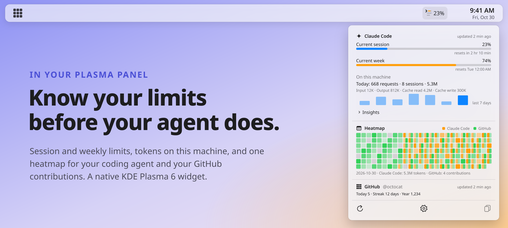
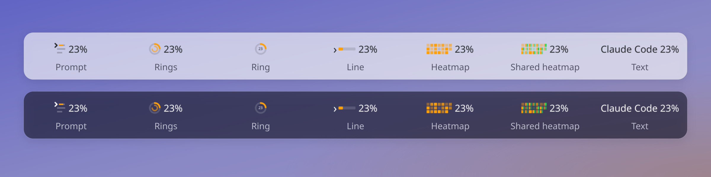

<p align="center">
  <picture>
    <source media="(prefers-color-scheme: dark)" srcset="docs/assets/header-dark.svg">
    
  </picture>
</p>

<p align="center">
  <a href="https://github.com/alexdoescodes/contribusage-arch/actions/workflows/ci.yml"></a>
  
  
  
  
  
  
  <a href="LICENSE"></a>
  <a href="https://github.com/kuehn-lars/contribusage/releases"></a>
</p>

<p align="center">
  <b>contribusage</b> is a KDE Plasma 6 widget that shows how much of your AI coding plan is left,<br>
  what your coding agent did on this machine, and your GitHub contributions, without ever touching your credentials.
</p>

<p align="center">
  <picture>
    <source media="(prefers-color-scheme: dark)" srcset="docs/assets/screenshot-dark.png">
    
  </picture>
</p>

## Highlights

- **Limits.** Every usage window your coding agent reports, such as the current session and the current week, with its percentage and the time it resets. Bars turn orange at 70 % and red at 90 %.
- **Activity.** Requests, sessions and tokens for today and the last seven days, read from the transcripts Claude Code already writes, plus the insights it prints with `/usage`.
- **Combined heatmap.** Your agent's daily activity and your GitHub contribution calendar in one grid, combined or stacked, with today's count and your streak.
- **Menu bar label.** Seven drawn styles, each in color or monochrome, and your choice of window: session, week, the highest one, or GitHub today.
- **Notifications.** Alerts at the thresholds you pick, and another one when a window resets.
- **Privacy.** No credentials read, no vendor backend called, no analytics. The only server the app itself talks to is `api.github.com`.
- **Native.** A Plasma widget in C++ and QML that runs inside plasmashell, with no extra process. Its resource budget is measured with L-7; the macOS app it was ported from used about 0.08 % CPU and 23 MB of memory probing every minute ([R-1](llm-wiki/research/r-1-probe-cost.md)).

<p align="center">
  
</p>

## How it works

contribusage reads only what your tools already show you, through their official interfaces.

| Data | Source | How often |
|---|---|---|
| Plan limits | `claude -p "/usage"`, the official CLI with your own login, run in an empty folder | Every 5 minutes by default, down to every minute |
| Activity | Claude Code's transcript files under `~/.claude/projects`, counted locally | As the files change |
| Contributions | GitHub's GraphQL API, with a read-only token you paste in | Every 10 minutes to 6 hours |

The windows you see are exactly the ones Claude Code prints for your plan. When Claude Code adds or drops a window, the app follows without an update.

### Privacy and safety

- **Your agent's credentials stay untouched.** The widget never reads Claude Code's credential file or its stored secrets and never calls `api.anthropic.com` or `claude.ai`. Instead of reading the OAuth token and calling an undocumented endpoint, it runs the `claude` binary the way you would in a terminal. The reasoning is in [SPEC §2.1](SPEC.md#21-why-principle-2-matters-claude-code).
- **The GitHub token lives in KWallet**, is never logged, and is never shown again after you connect.
- **Transcripts are only counted.** The app decodes the fields it counts (timestamps, models, token counts) and never keeps prompt or message text.
- **No telemetry, no cloud, no crash reporter.** Everything stays in `~/.local/share/contribusage` and the widget's own Plasma config.

## Requirements

- Arch Linux with KDE Plasma 6
- Claude Code installed and logged in, for its limits and activity
- A GitHub token, for contributions (optional)

## Status

This fork is the Linux port of the macOS app (SPEC §17.8). The port's milestones L-0 to L-7 are done: real Claude Code limits and activity, GitHub contributions, notifications, settings pages, the popup layout and the customization layers, and an Arch package. L-2c (transcripts synced from another machine) waits for a decision.

## Install the package

```bash
cd packaging/arch
makepkg -si
```

`makepkg` builds the checkout it sits in and runs the tests first. Then right-click the panel, choose "Add or Manage Widgets…", and add **contribusage**. Its settings (label style, notifications, Claude Code, GitHub, popup layout, appearance) open from the gear in the popup's footer.

## Build from source

```bash
sudo pacman -Syu --needed base-devel cmake ninja extra-cmake-modules qt6-base qt6-declarative libplasma kcoreaddons kconfig kirigami kwallet kcmutils plasma-sdk
cmake -B build -G Ninja
cmake --build build
QT_QPA_PLATFORM=offscreen ctest --test-dir build --output-on-failure
QT_PLUGIN_PATH=$PWD/build/bin plasmoidviewer -a org.contribusage.widget -f horizontal
```

## Roadmap

- **Linux port:** the milestones L-1 to L-7 in [SPEC §17.8](SPEC.md#178-linux-port-adr-041), ending with an Arch package.
- **Status line bridge:** Live limits after every message in an active Claude Code session, through Claude Code's documented status line ([T-6.2](SPEC.md#176-phase-6-optional-and-release-m5)).
- **More coding agents:** The provider framework is in place; Codex CLI is the next candidate ([ADR-037](llm-wiki/decisions/0037-no-second-provider-for-v1.md)).

## How this repository works

contribusage is built spec-first, with coding agents, and everything they need lives in the repository:

- [`SPEC.md`](SPEC.md) is the contract: requirements with stable IDs, the task plan, open research.
- [`llm-wiki/`](llm-wiki/) is the project's memory: an [Obsidian](https://obsidian.md) vault the agents maintain, following Andrej Karpathy's LLM-wiki pattern. It holds a page per module, the architecture decisions, research findings and a change log. Start at [`overview.md`](llm-wiki/overview.md), or open the folder as a vault for the graph view.
- [`AGENTS.md`](AGENTS.md) is the protocol every agent follows: orient in the vault, work against the spec, record what changed.

## Acknowledgements

- [**ccusage**](https://github.com/ryoppippi/ccusage) by [@ryoppippi](https://github.com/ryoppippi) is the reference implementation for counting Claude Code's tokens from its transcripts. contribusage's daily totals were checked against `ccusage daily` and match within 1 %.
- [**Claude Code**](https://code.claude.com) is the coding agent this app watches. The app reads it only through its official CLI and the transcript files it writes.
- Andrej Karpathy's [**LLM-wiki pattern**](llm-wiki/sources/karpathy-llm-wiki.md) shapes the project memory in `llm-wiki/`, kept in [**Obsidian**](https://obsidian.md).
- Apple's **Icon Composer** and **SF Symbols** gave the macOS app its icon and its interface symbols.
- [**Shields.io**](https://shields.io) draws the badges above.

## License

contribusage is released under the [MIT License](LICENSE).

## Trademarks

contribusage is an independent project. It is not affiliated with, endorsed by or sponsored by Anthropic or GitHub. Claude and Claude Code are trademarks of Anthropic, PBC. GitHub is a trademark of GitHub, Inc. Apple, macOS and Apple Silicon are trademarks of Apple Inc.
